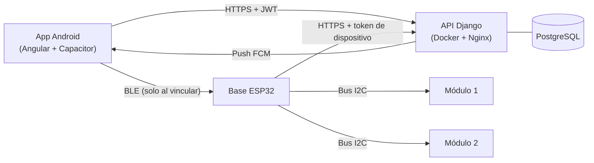

# e-Pillbox — pastillero electrónico modular

Sistema para que una persona tome sus medicamentos a tiempo y que sus cuidadores puedan comprobarlo. Tiene tres partes que
trabajan juntas:

- **La app** (Android, hecha con Angular + Capacitor): se registran los medicamentos, los horarios y el inventario. Suena una
  alarma nativa a la hora de cada toma y muestra el historial.
- **La API** (Django REST): guarda los datos, crea las tomas a su hora, manda las notificaciones push y habla con el pastillero.
- **El pastillero**: una **base** con un ESP32 y uno o varios **módulos** imantados, uno por medicamento. Cada módulo tiene
  un LED, un sensor de tapa y un botón. Avisa a la hora de la toma y registra si la tapa se abrió.



## Estructura del repositorio

```text
pastillero2026/
├── api_pillbox/      API REST (Django 5.2, DRF, SimpleJWT, PostgreSQL)
├── pillbox-app/      App Angular 20 que se compila a APK con Capacitor 8
│   ├── plugins/      Plugins nativos propios: aprovisionamiento BLE y alarma de medicación
│   └── android-config/  Configuración nativa de Android (Firebase, íconos, firma)
├── firmware/
│   ├── esp32_pillbox/   Firmware de la base (Arduino / ESP32)
│   ├── carcasa/         Carcasa en OpenSCAD, STL listos para imprimir y visor 3D
│   ├── prueba_hardware/ Sketch mínimo para probar LED, botón y buzzer
│   └── tools/           Simulador del ESP32 contra la API
├── deploy/           Configuración de Nginx y guía de despliegue
├── docs/             Documentación de desarrollo y manual de usuario
└── docker-compose.yml   Producción: Postgres + Django/Gunicorn + Nginx + Certbot
```

## Documentación

Toda la documentación de desarrollo está en [`docs/`](docs/README.md). Para empezar:

| Si quieres… | Lee |
|---|---|
| Entender cómo funciona el sistema completo | [Arquitectura](docs/01-arquitectura.md) |
| Levantar el proyecto en tu computador | [Instalación para desarrollo](docs/02-instalacion-desarrollo.md) |
| Consultar un endpoint | [API](docs/03-api.md) |
| Trabajar en la app o generar la APK | [App](docs/04-app.md) |
| Cargar el firmware o preparar una placa | [Firmware](docs/05-firmware.md) |
| Armar el pastillero | [Hardware](docs/06-hardware.md) |
| Publicar en el servidor | [Despliegue](docs/07-despliegue.md) |
| Resolver un error conocido | [Solución de problemas](docs/10-solucion-problemas.md) |

El manual para quien usa el pastillero está en [`docs/manual-usuario/`](docs/manual-usuario/).

## Inicio rápido (desarrollo)

Necesitas Python 3.11, Node.js 20 y PostgreSQL. La guía completa está en
[docs/02-instalacion-desarrollo.md](docs/02-instalacion-desarrollo.md).

```bash
# API
cd api_pillbox
python -m venv .venv && .venv/Scripts/activate      # en Linux/macOS: source .venv/bin/activate
pip install -r requirements.txt
cp .env.example .env                                # rellena SECRET_KEY y los datos de la BD
python manage.py migrate
python manage.py runserver

# App (en otra terminal)
cd pillbox-app
npm install
npm start                                           # http://localhost:4200
```

Para que la app use tu API local, cambia `apiUrl` en `pillbox-app/src/environments/environment.ts`.

## Pruebas

```bash
cd api_pillbox && python manage.py test core       # API
cd pillbox-app && npm test                           # App
```

Hay más detalles en [docs/09-pruebas.md](docs/09-pruebas.md).

## Estado

| Parte | Estado |
|---|---|
| API | En producción en `https://epillbox.duckdns.org/api/` |
| App Android | APK 1.3.0, distribuida a mano (sin Google Play) |
| Firmware | `modular-1.0.0`: base con módulos I2C; sin módulos funciona como pastillero de un compartimento |
| Carcasa | Diseño completo; faltan medidas por confirmar con las piezas reales |

Los cambios por versión están en el [CHANGELOG](CHANGELOG.md).
