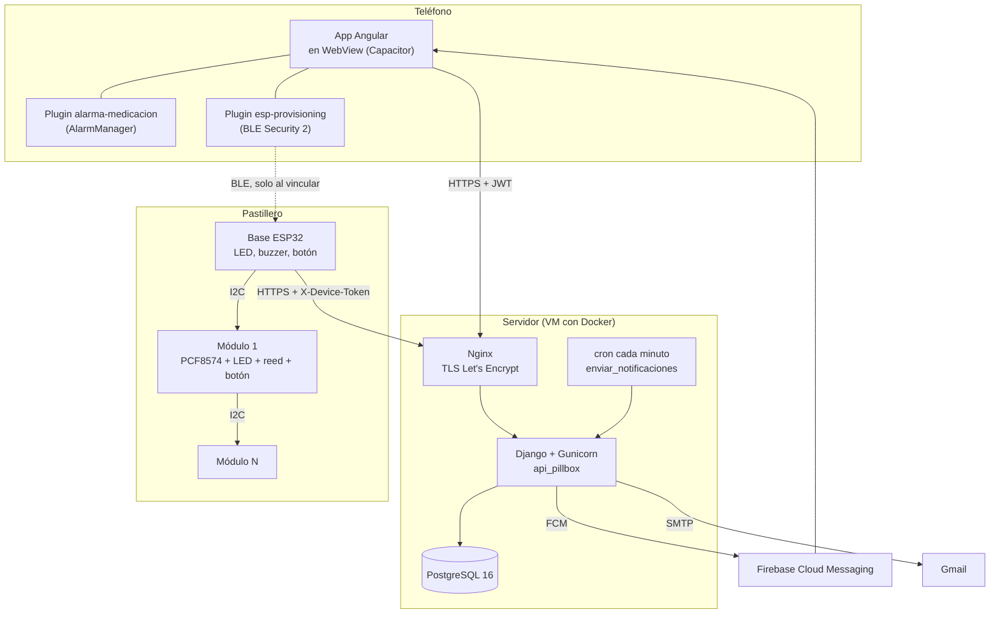
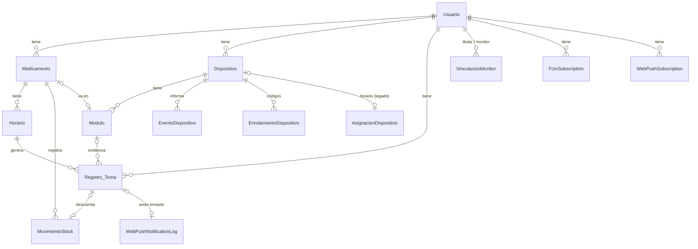
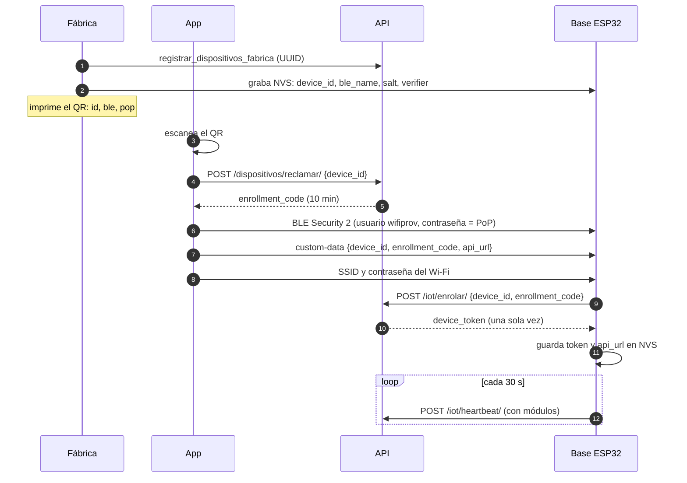
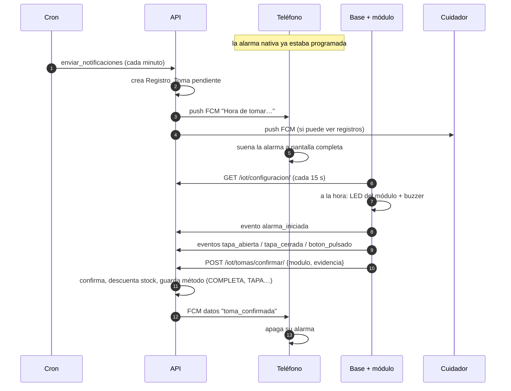

# Arquitectura

## 1. Visión general

e-Pillbox tiene tres componentes de software y uno físico:

| Componente | Tecnología | Carpeta | Responsabilidad |
|---|---|---|---|
| API | Python 3.11, Django 5.2, DRF 3.18, SimpleJWT, PostgreSQL | `api_pillbox/` | Fuente de verdad: cuentas, medicamentos, horarios, tomas, inventario, placas. Crea las tomas y manda los avisos |
| App | Angular 20, Angular Material, Capacitor 8 | `pillbox-app/` | Interfaz del paciente y del cuidador. Alarma nativa y vinculación de la placa |
| Firmware | Arduino sobre ESP32 (core 3.3), ArduinoJson 7 | `firmware/esp32_pillbox/` | Detecta módulos, hace sonar la alarma, lee tapa y botón, informa a la API |
| Carcasa | OpenSCAD, impresión 3D | `firmware/carcasa/` | Base y módulos que se unen con imanes y llevan el bus I2C |

**Principios del diseño**

- **El servidor manda.** La app y la placa no deciden qué toma toca: el servidor calcula los horarios, crea las tomas y
  resuelve a qué toma corresponde una confirmación.
- **Todo es idempotente.** La red falla; las peticiones se reintentan con el mismo `evento_id` o chocan con una restricción
  única, y nunca se duplica una toma ni se descuenta dos veces el stock.
- **Varios canales de aviso, independientes.** El teléfono tiene su propia alarma programada aunque se caiga el servidor; la
  placa suena aunque el teléfono esté apagado; el push avisa además a los cuidadores.
- **La placa no guarda secretos reutilizables.** El PoP del QR no está en la placa (solo un verifier SRP) y su token se guarda
  en el servidor como hash.

## 2. Backend (`api_pillbox`)

Un solo proyecto Django (`api_pillbox/`) con una sola app (`core/`).

| Archivo de `core/` | Qué contiene |
|---|---|
| `models.py` | Todos los modelos (ver [sección 3](#3-modelo-de-datos)) |
| `views.py` | Vistas REST de la app y de `/api/iot/`, y las dos páginas HTML públicas |
| `serializers.py` | Validación y forma de las respuestas. Login y refresh propios para el modelo `Usuario` |
| `authentication.py` | `UsuarioJWTAuthentication`: el JWT apunta a `core.Usuario`, no al `User` de Django |
| `modulos.py` | Pastillero modular: latido con módulos, eventos de sensores, confirmación con evidencia |
| `stock.py` | Descuento atómico de stock al confirmar, reposición y ajustes |
| `inventory.py` | Cálculo de cobertura (cuántos días alcanza el stock) |
| `notifications.py` | Creación de tomas vencidas, push FCM y Web Push, sincronización de alarmas |
| `signals.py` | Al cambiar un horario o el nombre de un medicamento, reprograma las alarmas del teléfono |
| `vinculaciones.py` | Permisos de los monitores y correo de invitación |
| `verificacion.py`, `restablecer_contrasena.py` | Tokens firmados para los correos |
| `fabrica.py` | Identidad de fábrica de cada ESP32: UUID, PoP, verifier SRP, QR |
| `scheduler.py` | APScheduler en memoria, solo para desarrollo |
| `management/commands/` | `enviar_notificaciones` (cron) y `registrar_dispositivos_fabrica` |

**Decisiones a tener en cuenta**

- `Usuario` es un modelo propio, no el `User` de Django: tiene `correo` como identificador y `password` con hash de Django
  (`make_password`). El panel `/admin/` usa los usuarios de Django, que son otros.
- No hay Celery ni colas: las tareas periódicas las hace un cron del sistema que ejecuta
  `python manage.py enviar_notificaciones` una vez por minuto.
- Zona horaria fija: `America/Bogota`. Los horarios se calculan en hora local.

## 3. Modelo de datos

| Modelo | Para qué sirve | Campos clave |
|---|---|---|
| `Usuario` | Cuenta de la app | `correo` (único), `password` (hash), `activo`, `correo_verificado` |
| `Medicamento` | Lo que toma la persona | `nombre`, `dosis`, `stock` |
| `Horario` | Cuándo se toma | `hora_toma` (ancla), `frecuencia` (horas), `cantidad_por_toma`, `fecha_inicio`, `tipo_duracion` (`DIAS`/`FECHA`/`INDEFINIDO`), `activo`, `eliminado` |
| `Registro_Toma` | Una toma concreta | `fecha_hora_programada`, `fecha_hora_real` (null = pendiente), `origen`, `modulo`, `apertura_en`, `cierre_en`, `boton_en`. Única por `(usuario, horario, fecha_hora_programada)` |
| `MovimientoStock` | Auditoría del inventario | `tipo`, `cantidad`, `stock_anterior`, `stock_nuevo`, `motivo`. Se valida que `stock_nuevo = stock_anterior + cantidad` |
| `Dispositivo` | La base ESP32 de un usuario | `identificador` (UUID de fábrica), `token_dispositivo_hash`, `ultimo_latido`, `version_firmware`, `rssi` |
| `DispositivoFabrica` | UUID dado de alta en fábrica y aún no reclamado | `identificador` |
| `EnrolamientoDispositivo` | Código temporal para que la placa obtenga su token | `codigo_hash`, `expira_en` (10 min), `intentos_fallidos` (máx. 5) |
| `Modulo` | Compartimento de una base | `numero_modulo` (1-16), `id_medicamento`, `detectado`, `tapa_abierta`. Único por `(dispositivo, numero)` |
| `EventoDispositivo` | Lo que informó la placa | `evento_id` (UUID único), `tipo`, `fecha_dispositivo`, `datos` |
| `AsignacionDispositivo` | Horario asignado a mano a una base (firmware antiguo de un compartimento) | `id_horario` |
| `VinculacionMonitor` | Un monitor ve los datos de un titular | `estado`, `puede_ver_medicamentos`, `puede_ver_horarios`, `puede_ver_registros` |
| `FcmSubscription`, `WebPushSubscription` | Destinos de los push | `token` / `endpoint` |
| `WebPushNotificationLog` | Marca que el aviso de una toma ya se envió (sirve de candado) | `registro` (uno a uno), `status` |

Borrados: los horarios se eliminan de forma lógica (`eliminado = true`) para no perder el historial. Borrar un usuario borra
en cascada todo lo suyo. `MovimientoStock` protege a su medicamento: un medicamento con movimientos no se puede borrar a
nivel de base de datos.

## 4. Flujos principales

### 4.1 Vincular una base nueva

- Sin el QR (que lleva el PoP) nadie puede conectarse a la placa por BLE, y sin el UUID dado de alta nadie puede reclamarla.
- Para cambiar de Wi-Fi o de dueño: mantener el botón de la base 5 s borra la configuración local. Para otro dueño, antes hay
  que eliminar el dispositivo en la app.

### 4.2 Una toma, de principio a fin

La toma también se puede confirmar desde la app (`PATCH /api/registros/{id}/`) o con "Ya lo tomé" en la alarma del teléfono.
En todos los casos el servidor avisa al resto (teléfonos por FCM y la placa en su siguiente consulta) para que dejen de sonar.

Si nadie confirma, la placa se apaga a los 10 minutos y envía `alarma_omitida`, y la alarma del teléfono también se apaga
sola. La toma queda pendiente y la app la muestra como omitida. Aún se puede confirmar desde la placa hasta 6 horas después.

### 4.3 Alarmas en el teléfono

Hay tres mecanismos, del más fiable al menos fiable:

1. **Alarma nativa** (plugin `capacitor-alarma-medicacion`): `AlarmManager.setAlarmClock` con las tomas de los próximos 3 días.
   Suena aunque no haya red ni servidor. La programa la app al abrirse y el servidor la actualiza por FCM
   (`sincronizar_alarmas`) cada vez que cambia un horario.
2. **Push FCM** desde el servidor: llega también a los cuidadores.
3. **Recordatorio dentro de la app** (`MedicationReminderService`): revisa cada 10 s mientras la app está abierta y muestra un
   modal con un margen de 15 minutos.

### 4.4 Inventario

Cada confirmación descuenta `cantidad_por_toma` dentro de la misma transacción que marca la toma (`stock.py`), con un bloqueo de
fila para que dos confirmaciones simultáneas no dejen el stock mal. Si no hay unidades suficientes, la toma no se confirma
(`409`). La cobertura se calcula aparte (`inventory.py`) y no modifica nada.

### 4.5 Cuidadores

Un titular invita a un monitor por correo. Cuando el monitor acepta, la app le muestra un selector de cuenta: al elegir la del
titular, las páginas de Medicamentos, Horarios y Registros piden los datos con `?titular=<id>`. El servidor comprueba el
permiso en cada petición; el selector de la app es solo la interfaz.

## 5. Comunicación y formatos

| Canal | Protocolo | Autenticación | Notas |
|---|---|---|---|
| App → API | HTTPS, JSON | JWT Bearer | El WebView de Capacitor tiene origen `https://localhost`, que debe estar en `CORS_ALLOWED_ORIGINS` |
| Base → API | HTTPS, JSON | `X-Device-Id` + `X-Device-Token` | Valida el servidor con el certificado raíz ISRG Root X1 (`secrets.h`) |
| App → Base | BLE, protocolo de aprovisionamiento de ESP-IDF | Security 2 (SRP-6a) con el PoP del QR | Solo durante la vinculación |
| Base → módulos | I2C a 3,3 V (SDA 21, SCL 22) | — | Número = 8 − (dirección & 7): 0x27 es el módulo 1 y 0x20 el 8 (0x3F-0x38 en el PCF8574A). El servidor admite 1-16; el firmware usa 1-8 |
| API → teléfono | Firebase Cloud Messaging | Cuenta de servicio | Prioridad alta, para que llegue en modo Doze |
| API → correo | SMTP de Gmail | Contraseña de aplicación | Sin credenciales, los correos se imprimen en la consola |

## 6. Entornos

| Entorno | API | App | Notas |
|---|---|---|---|
| Local | `runserver` en `localhost:8000`, scheduler en memoria | `ng serve` en `localhost:4200`, aprovisionamiento simulado | Ver [02-instalacion-desarrollo.md](02-instalacion-desarrollo.md) |
| Emulador Android | `http://10.0.2.2:8000/api/` | APK debug | `10.0.2.2` es el `localhost` del PC visto desde el emulador |
| Túnel | Dev Tunnels de Microsoft | APK compilada con la URL del túnel | Solo para probar con una placa real sin desplegar |
| Producción | `https://epillbox.duckdns.org/api/` en Docker | APK release | Ver [07-despliegue.md](07-despliegue.md) |
