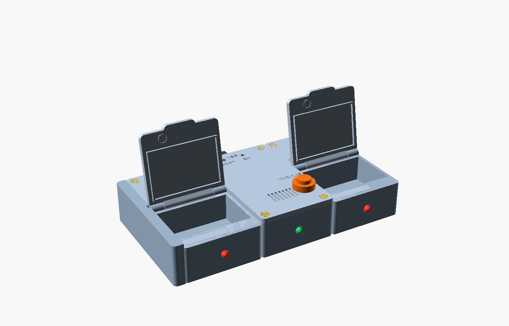
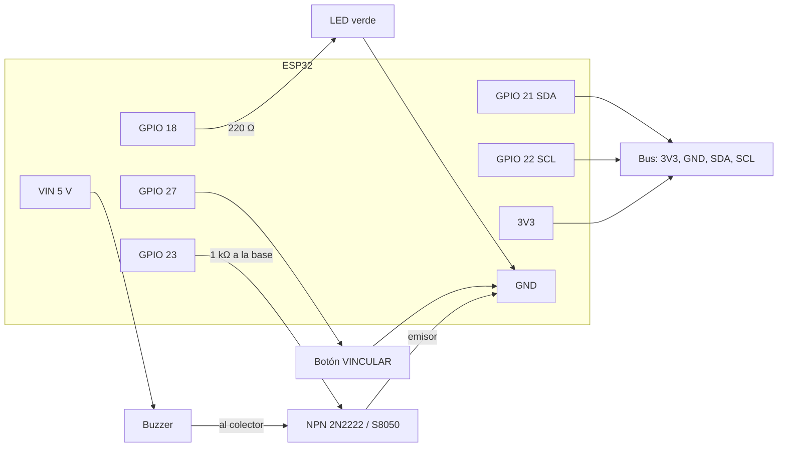

# Hardware

Electrónica, materiales y armado del pastillero. Las medidas exactas de cada pieza, las imágenes y cómo regenerar los STL
están en [`firmware/carcasa/README.md`](../firmware/carcasa/README.md); los pines del módulo, en
[`firmware/PROTOCOLO_MODULOS.md`](../firmware/PROTOCOLO_MODULOS.md).



## 1. Configuración

El pastillero es una fila de unidades de 70 × 100 × 32 mm que se unen de lado con imanes. Una tira de 4 pines lleva el bus de
una a otra:

```text
[tapa lateral] [Módulo 1] [Base ESP32] [Módulo 2]
```

- **Base:** ESP32, LED verde, buzzer, botón VINCULAR y la entrada USB-C. No guarda pastillas.
- **Módulo:** una cámara de pastillas (unos 49 cm³) con tapa de bisagra. Lleva una placa PCF8574, LED rojo, sensor reed de
  la tapa y un pulsador.
- Cualquier unidad encaja a cada lado de cualquier otra: la cara izquierda lleva la tira macho y la derecha, la hembra.

## 2. Lista de materiales

Para una base con 2 módulos (la configuración de la carcasa actual).

**Electrónica de la base**

| Cant. | Componente | Notas |
|---|---|---|
| 1 | ESP32 DevKit de 30 pines con USB-C | 52,5 × 28 mm. Probado con chip USB CP210x |
| 1 | Placa perforada 40 × 60 mm | Formato 4 × 6 cm |
| 2 | Tira de zócalo hembra de 15 pines, 8,5 mm de alto | El ESP32 va enchufado, se puede sacar |
| 1 | Buzzer activo Ø 12 × 9 mm | A 5 V a través del transistor |
| 1 | Transistor NPN 2N2222 o S8050 | Maneja el buzzer |
| 1 | Resistencia 1 kΩ | Base del transistor |
| 1 | LED verde de 5 mm | Estado. Si es muy brillante, 68-100 Ω en lugar de 220 Ω |
| 1 | Resistencia 220 Ω | LED de estado |
| 1 | Pulsador de panel de 12 mm, normalmente abierto (tipo PBS-33B) | Botón VINCULAR |
| 1 | Conector JST-XH de 4 pines | De la placa perforada al bus |
| 1 | Cable USB-C y cargador de 5 V | Alimentación |

**Electrónica de cada módulo** (×2)

| Cant. | Componente | Notas |
|---|---|---|
| 1 | Adaptador I2C de LCD1602 con PCF8574T | 41,5 × 19,3 mm. Dirección 0x27 de fábrica |
| 1 | LED rojo de 5 mm | |
| 1 | Resistencia 220 Ω | LED del módulo |
| 1 | Interruptor reed (cuerpo de 14 × 2 mm) | Sensor de la tapa |
| 1 | Imán de neodimio Ø 6 × 2 mm | En la tapa, sobre el reed |
| 1 | Pulsador de panel de 12 mm, normalmente abierto | Confirmar la toma |
| — | Cable de 4 hilos | Reed y LED hasta la bahía |

**Unión y montaje** (base + 2 módulos)

| Cant. | Componente |
|---|---|
| 3 + 3 | Tiras macho y hembra de 4 pines de 2,54 mm (una de cada por unidad) |
| 14 | Imanes de neodimio Ø 8 × 3 mm (2 por cara lateral y 2 para la tapa lateral) |
| 12 + 12 | Tornillos M3 × 10 avellanados (DIN 7991) y tuercas M3 (DIN 934), 4 por unidad |
| — | Filamento de 1,75 mm para el pasador de cada bisagra |
| — | Epoxi (tuercas), cianoacrilato (imanes y LED), estaño |

**Impresión 3D:** 11 piezas en PETG o PLA, capa de 0,2 mm, 3 perímetros, relleno del 20 % y sin soportes. Todas juntas están en
`firmware/carcasa/stl/pastillero_completo.stl` (unos 268 × 257 mm de cama). La lista por pieza está en el README de la carcasa.

## 3. Conexiones

### 3.1 Base



| Pin del ESP32 | Va a | Detalle |
|---|---|---|
| GPIO 18 | LED de estado | Ánodo por 220 Ω; cátodo a GND |
| GPIO 27 | Botón VINCULAR | El otro borne a GND (pull-up interno). 5 s = borrar Wi-Fi y volver a vincular |
| GPIO 23 | Buzzer | Por 1 kΩ a la base del NPN; buzzer entre VIN (5 V) y el colector; emisor a GND |
| GPIO 21, GPIO 22 | Bus (SDA, SCL) | Por el JST al conector de la cara derecha |
| 3V3, GND | Bus | Alimentan los módulos |

### 3.2 Módulo

Los cables se sueldan en la punta de los pines de la tira de 16 del adaptador (no hay sitio para conectores dupont):

| Pin de la tira | Señal del PCF8574 | Conexión |
|---|---|---|
| 1 (VSS) | GND | Reed y pulsador |
| 2 (VDD) | 3,3 V | Ánodo del LED, por 220 Ω |
| 4 (RS) | P0 | Cátodo del LED (`LOW` enciende) |
| 5 (RW) | P1 | Reed (`LOW` = tapa cerrada) |
| 6 (E) | P2 | Pulsador (`LOW` = pulsado) |

El conector de 4 pines del adaptador (GND, VCC, SDA, SCL) va a las tiras macho y hembra del módulo: el bus atraviesa cada
módulo y sigue al siguiente. **No uses P3**: en este adaptador va al transistor de la luz de la pantalla.

### 3.3 Número de cada módulo

Se fija soldando los puentes A0-A2 del adaptador. Graba el mismo número en la tapa del módulo.

| Puentes unidos | Dirección (PCF8574 / PCF8574A) | Módulo |
|---|---|---|
| Ninguno (de fábrica) | 0x27 / 0x3F | 1 |
| A0 | 0x26 / 0x3E | 2 |
| A1 | 0x25 / 0x3D | 3 |
| A0 y A1 | 0x24 / 0x3C | 4 |

La tabla completa, hasta el módulo 8, está en el protocolo. Dos módulos con la misma dirección se pisan en el bus.

## 4. Armado

1. **Imprime primero una sola base de módulo con su tapa** y comprueba con las piezas reales la placa PCF8574, el reed, el imán
   y la bisagra. Después imprime el resto.
2. **Tuercas:** mete cada tuerca M3 a presión en el hueco hexagonal de lo alto de su pilar, a ras, con una gota de epoxi sin
   manchar la rosca. Deja secar.
3. **Base:** suelda en la placa perforada los zócalos, el transistor, las resistencias y el JST. Coloca el buzzer en su
   anillo (patas dobladas 90° hacia atrás), el LED desde fuera y el botón en la tapa. Enchufa el ESP32 con el USB contra la
   pared trasera.
4. **Prueba la base** con `firmware/prueba_hardware` antes de cerrar: el LED y el buzzer deben seguir al botón.
5. **Módulo:** reed en el canal del borde, LED desde el frente, mazo de 4 hilos por el canal recto hasta la bahía y soldado
   a la tira del adaptador. Pulsador en la cubierta. Imán en la tapa, encima del reed. Pasador de filamento en la bisagra.
6. **Comprueba el reed** con un tester: con la tapa cerrada (1,8 mm entre imán y reed) debe cerrar el contacto.
7. **Imanes de la unión:** pega primero los de las caras izquierdas, todos con la misma cara hacia fuera. Cada imán de una
   cara derecha se orienta poniéndolo sobre uno ya pegado.
8. **Une las unidades** de frente, con todo apagado. Para separarlas, tira de lado sin torcer.
9. **Graba la identidad y el firmware** ([05-firmware.md](05-firmware.md)) y pega el QR en la base.
10. **Prueba con módulos:** con el monitor serie, `probar 1` hace parpadear el LED del módulo 1 y suena 3 s.

## 5. Consumo y alimentación

Se alimenta por el USB-C de la DevKit con un cargador de 5 V. El buzzer va a 5 V por el transistor: un buzzer de más de 20 mA
no se puede conectar directo a un GPIO. Los módulos se alimentan a 3,3 V desde el regulador de la DevKit. No hay batería: si se
va la luz, la placa deja de sonar, pero la alarma del teléfono sigue funcionando.

## 6. Pendiente

- Confirmar con las piezas reales: placa PCF8574, conector de 4 pines, tira macho, reed e imanes (ver "Pendiente" en el README
  de la carcasa).
- Esquemático formal (KiCad) y fotos del armado real.
- Batería de respaldo.
