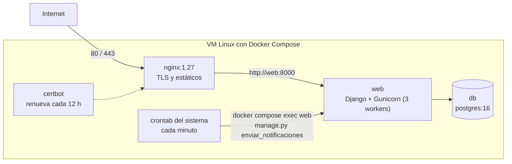

# Despliegue

Cómo funciona la producción y cómo operarla. La guía paso a paso para montar un servidor desde cero (crear la VM, dominio,
certificado, cron y migración entre servidores) está en [`deploy/README-deploy.md`](../deploy/README-deploy.md).

## 1. Arquitectura de producción



| Servicio | Imagen | Función | Volúmenes |
|---|---|---|---|
| `db` | `postgres:16-alpine` | Base de datos | `pillbox_db_data` |
| `web` | Construida desde `api_pillbox/Dockerfile` (Python 3.11) | Espera a la BD, migra, `collectstatic` y arranca Gunicorn (`entrypoint.sh`) | `static_data` |
| `nginx` | `nginx:1.27-alpine` | Termina TLS, sirve `/static/` y hace de proxy a `web` | Configuración de `deploy/nginx/`, certificados |
| `certbot` | `certbot/certbot` | Renueva el certificado de Let's Encrypt | `certbot_www`, `certbot_conf` |

| Dato | Valor |
|---|---|
| Dominio | `epillbox.duckdns.org` (DuckDNS) |
| URL de la API | `https://epillbox.duckdns.org/api/` |
| Certificado | Let's Encrypt, cadena hasta ISRG Root X1 |
| Repo en la VM | `~/pastillero2026` |

El proveedor, la IP y el acceso SSH del servidor actual están en `deploy/README-deploy.md`.

> **No cambies de dominio.** La URL está compilada en la APK (`environment.ts`) y guardada en la NVS de cada placa al
> vincularla. Otro dominio obliga a sacar una APK nueva y a revincular todos los pastilleros.

## 2. Variables de entorno

Viven en `api_pillbox/.env` en la VM (nunca en git). La plantilla es
[`api_pillbox/env.production.example`](../api_pillbox/env.production.example). Hace falta además un `.env` en la raíz del repo
con `DB_NAME`, `DB_USER` y `DB_PASSWORD`, porque Docker Compose los sustituye en `docker-compose.yml`.

| Variable | Obligatoria | Producción | Para qué |
|---|---|---|---|
| `SECRET_KEY` | Sí | Larga y aleatoria, solo del servidor | Firma los JWT y los tokens de los correos. **Cambiarla cierra todas las sesiones** |
| `DEBUG` | — | `False` | Con `False`, `ALLOWED_HOSTS` no puede ser `*` |
| `ALLOWED_HOSTS` | Sí | `epillbox.duckdns.org` | Hosts aceptados |
| `DB_NAME`, `DB_USER`, `DB_PASSWORD` | Sí | Contraseña fuerte, distinta de la de desarrollo | Postgres |
| `DB_HOST`, `DB_PORT` | — | `db`, `5432` (los fija `docker-compose.yml`) | |
| `CORS_ALLOWED_ORIGINS` | Sí | `https://epillbox.duckdns.org,https://localhost` | `https://localhost` es el origen del WebView de la APK: sin él, el login falla por CORS |
| `FRONTEND_URL` | Sí | `https://epillbox.duckdns.org` | Enlaces de los correos. Debe ser el dominio del backend, que sirve las páginas |
| `EMAIL_HOST_USER`, `EMAIL_HOST_PASSWORD` | Recomendada | Cuenta de Gmail y contraseña de aplicación | Correos de verificación, restablecimiento e invitaciones |
| `DEFAULT_FROM_EMAIL` | — | | Remitente visible |
| `FIREBASE_CREDENTIALS_JSON` | Recomendada | JSON de la cuenta de servicio, en una sola línea | Push FCM a la app Android. Vacía = sin push |
| `WEBPUSH_PUBLIC_KEY`, `WEBPUSH_PRIVATE_KEY`, `WEBPUSH_SUBJECT` | — | | Push al navegador |
| `PAGE_SIZE` | — | `10` | Tamaño de página |
| `GUNICORN_WORKERS` | — | `3` (o `2` con 1 GB de RAM) | Procesos de Gunicorn |
| `RUN_INPROCESS_SCHEDULER` | — | **No definir** | Con `DEBUG=False` queda apagado. Activarlo con varios workers duplica los push |

## 3. Tareas programadas

| Qué | Cuándo | Dónde |
|---|---|---|
| `manage.py enviar_notificaciones` | Cada minuto | Crontab del usuario de la VM (no dentro del contenedor, para que sobreviva a un reinicio) |
| Rotación del log de notificaciones | Diaria, 7 copias | `logrotate` con un archivo de estado propio |
| Renovación del certificado | Cada 12 h (solo renueva si va a vencer) | Contenedor `certbot` |

```cron
* * * * * cd ~/pastillero2026 && docker compose exec -T web python manage.py enviar_notificaciones >> ~/pillbox-notificaciones.log 2>&1
```

Si el cron se detiene: no se crean tomas a su hora, no hay push y los cuidadores no se enteran. La alarma nativa del teléfono
y la de la placa siguen funcionando, y la placa crea la toma al confirmarla.

## 4. Operación

### Actualizar a una versión nueva

```bash
cd ~/pastillero2026
git pull
docker compose up -d --build
docker compose logs -f web      # comprueba que migre y arranque
```

Las migraciones se aplican solas al arrancar. Antes de una migración que cambie datos, haz una copia de seguridad.

### Copia de seguridad y restauración

```bash
# Copia (formato custom de pg_dump)
docker compose exec -T db sh -c 'pg_dump -U "$POSTGRES_USER" -d "$POSTGRES_DB" -Fc' > ~/pillbox-$(date +%F).dump

# Restaurar en una base vacía
docker compose up -d db
docker compose exec -T db sh -c 'pg_restore -U "$POSTGRES_USER" -d "$POSTGRES_DB" --no-owner --no-privileges' < ~/pillbox-AAAA-MM-DD.dump
docker compose up -d
```

Guarda las copias **fuera de la VM**. Junto con la copia hay que conservar `api_pillbox/.env`: sin la misma `SECRET_KEY`, las
sesiones de la app se cierran; los tokens de las placas sí siguen valiendo porque son hashes en la base de datos.

### Comprobaciones rápidas

```bash
docker compose ps                                              # los 4 servicios "Up"
curl -i https://epillbox.duckdns.org/api/proximos-horarios/    # 401 = la API responde
docker compose logs --tail 100 web                             # errores de Django
docker compose logs nginx | grep /api/iot/ | tail              # ¿llegan los latidos de las placas?
tail ~/pillbox-notificaciones.log                              # ¿corre el cron? (vacío es normal si no hay tomas)
grep CRON /var/log/syslog | tail
```

### Comandos de gestión útiles

```bash
docker compose exec web python manage.py createsuperuser
docker compose exec web python manage.py registrar_dispositivos_fabrica --cantidad 1
docker compose exec web python manage.py shell
docker compose exec db psql -U "$DB_USER" -d "$DB_NAME"
```

`registrar_dispositivos_fabrica` escribe los archivos dentro del contenedor (`/app/fabrica_salida`). Cópialos con
`docker compose cp web:/app/fabrica_salida ./` y bórralos después del contenedor: llevan el PoP.

## 5. Publicar la app

No hay tienda: la APK release se genera en el PC de desarrollo ([04-app.md](04-app.md#6-generar-la-apk)) y se reparte a mano.
Antes de repartirla:

1. `apiUrl` apunta a producción.
2. Se subió `versionCode`.
3. Está firmada con el keystore de siempre (`apksigner verify --print-certs`).
4. Se añadió la versión al [CHANGELOG](../CHANGELOG.md) y a la tabla de `android-config/README.md`.

## 6. Pendiente

Ver [08-seguridad.md](08-seguridad.md#5-pendientes): cabeceras de seguridad en Nginx, flags `SECURE_*` de Django y quitar la
regex de Dev Tunnels de CORS en producción. También faltan monitoreo (avisar si la API o el cron se caen) y copias de seguridad
automáticas.
